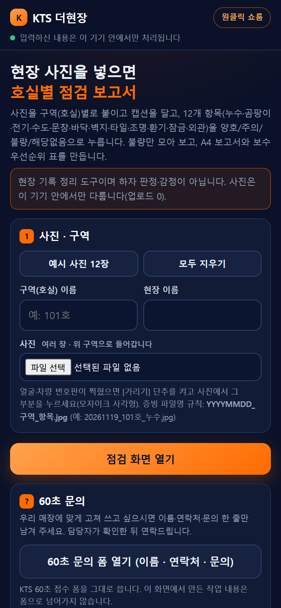
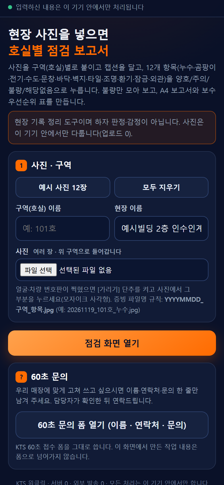
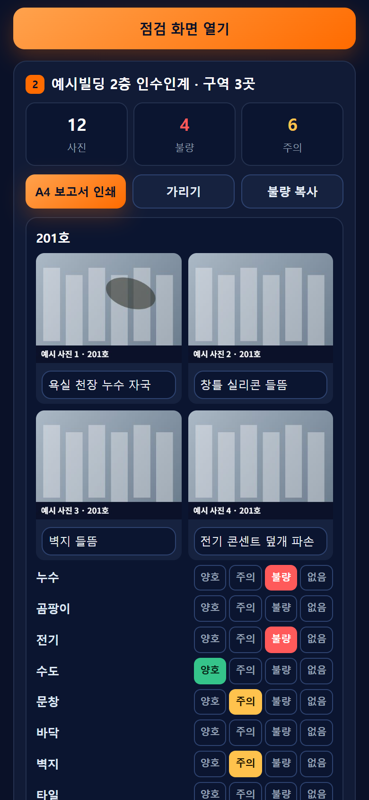

# KTS 더현장 — 현장 사진 → 호실별 상태 점검 보고서 사용설명서

- 앱: `oneclick/sitecheck.html` (단일 HTML · 설치 없음 · 서버 0)
- 현장 사진을 호실·구역별로 넣고 캡션을 단 뒤 12항목(누수·곰팡이·전기 등)을 양호/주의/불량/해당없음으로 탭하면, 불량 모아보기·보수 우선순위 표·사진 포함 A4 보고서를 만듭니다. 사진은 기기 안에서만 다루며 하자 판정이 아닙니다.
- 입력하신 내용은 이 기기 안에서만 처리됩니다.

## ① 누르는 곳

[예시 사진 12장]을 누르거나, 구역 이름을 적고 사진을 고르세요.

## ② 입력

[점검 화면 열기]를 누르고 항목마다 상태를 탭합니다. 얼굴·번호판은 [가리기]를 켜고 사진을 누릅니다.

## ③ 결과

불량 목록·우선순위 표가 나옵니다. [A4 보고서 인쇄] · [불량 복사].

## 60초 문의
화면 맨 아래 **[60초 문의 폼 열기]** 를 누르면 KTS 60초 접수 폼(`misa-1116/form.html`)이 열립니다. 이름·연락처·문의만 남기면 됩니다.

> 390px 실물 캡처: `390_sitecheck.png` · 실제로 누른 자리 기록: `shots/sitecheck/marks.json` · 검증 로그: `shots/sitecheck/run_log.txt`