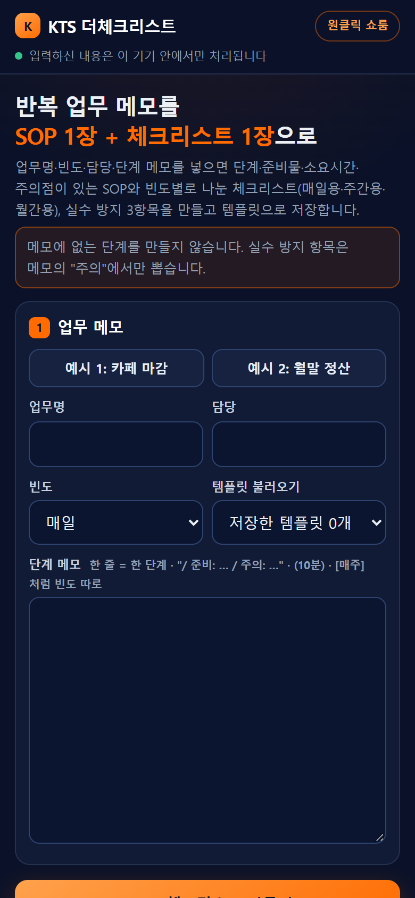
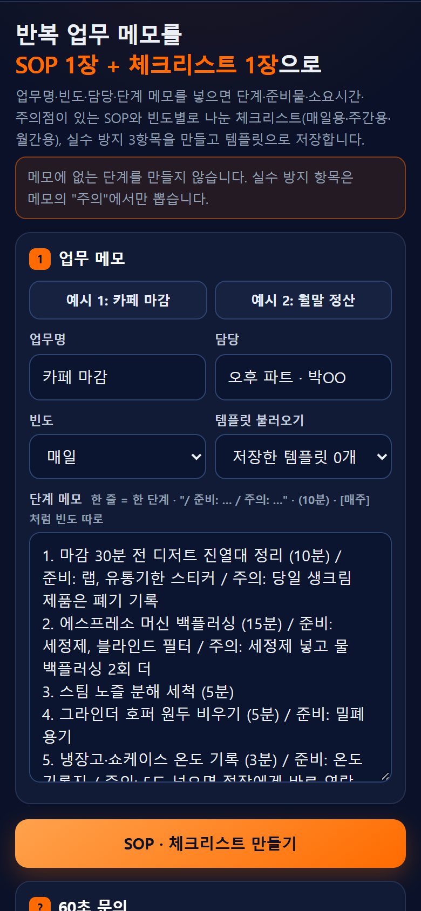
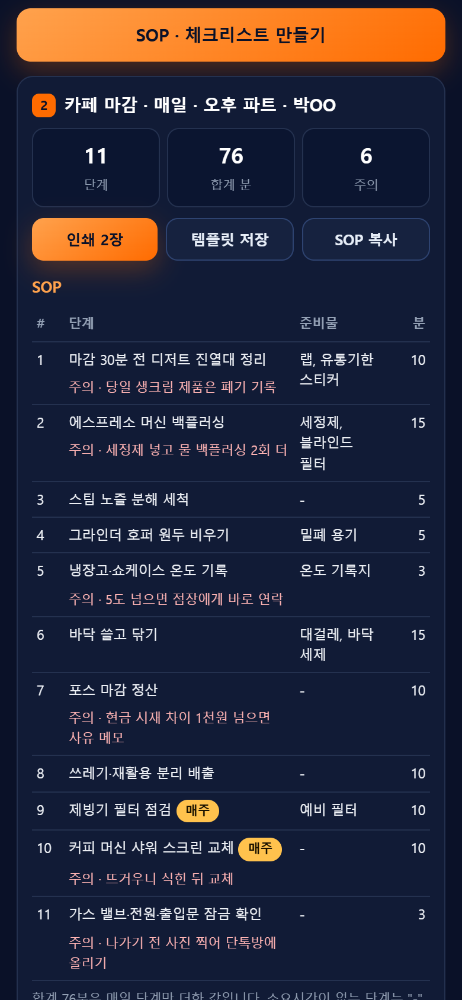

# KTS 더체크리스트 — 반복 업무 → SOP + 체크리스트 세트 사용설명서

- 앱: `oneclick/sopset.html` (단일 HTML · 설치 없음 · 서버 0)
- 업무명·빈도·담당·단계 메모를 넣으면 단계·준비물·소요시간·주의점이 있는 SOP 1장과 빈도별(매일·매주·매월) 체크리스트 1장, 실수 방지 3항목을 만들고 템플릿으로 저장합니다. 메모에 없는 단계는 만들지 않습니다.
- 입력하신 내용은 이 기기 안에서만 처리됩니다.

## ① 누르는 곳

[예시 1: 카페 마감] 또는 [예시 2: 월말 정산]을 누르세요. 단계는 "/ 준비: … / 주의: …" · (10분) · [매주]로 적습니다.

## ② 입력

업무명·빈도·담당을 확인하고 [SOP · 체크리스트 만들기]를 누릅니다.

## ③ 결과

SOP 표·실수 방지 3항목·빈도별 체크리스트가 나옵니다. 칸을 체크하면 저장됩니다. [인쇄 2장] · [템플릿 저장] · [SOP 복사].

## 60초 문의
화면 맨 아래 **[60초 문의 폼 열기]** 를 누르면 KTS 60초 접수 폼(`misa-1116/form.html`)이 열립니다. 이름·연락처·문의만 남기면 됩니다.

> 390px 실물 캡처: `390_sopset.png` · 실제로 누른 자리 기록: `shots/sopset/marks.json` · 검증 로그: `shots/sopset/run_log.txt`