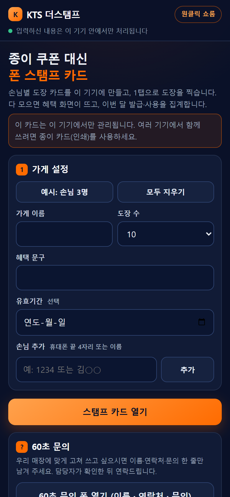
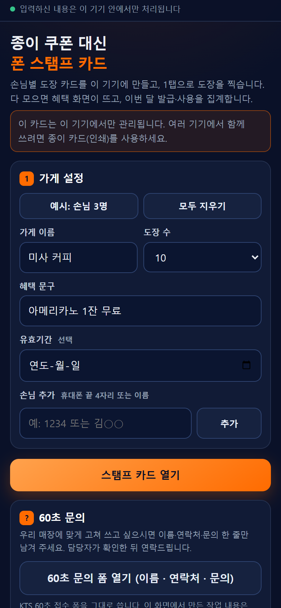
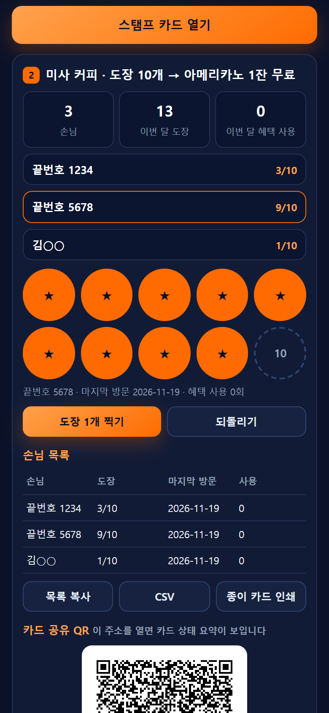

# KTS 더스탬프 — 종이 스탬프·쿠폰 → 폰 스탬프 카드 사용설명서

- 앱: `oneclick/stampcard.html` (단일 HTML · 설치 없음 · 서버 0)
- 가게 이름·도장 수·혜택을 정하고 손님(휴대폰 끝 4자리 또는 이름)을 추가하면 1탭으로 도장을 찍고, 다 모으면 혜택 화면이 뜹니다. 이번 달 도장·혜택 사용을 집계하고 종이 카드도 인쇄합니다. 이 기기에서만 관리됩니다.
- 입력하신 내용은 이 기기 안에서만 처리됩니다.

## ① 누르는 곳

[예시: 손님 3명]을 누르거나 가게 설정 후 손님을 추가하세요.

## ② 입력

[스탬프 카드 열기]를 누르고 손님을 고릅니다.

## ③ 결과

[도장 1개 찍기] · [되돌리기]. 도장이 다 차면 혜택 화면을 손님께 보여 주고 [혜택 사용 처리]. 목록은 [CSV] · [종이 카드 인쇄].

## 60초 문의
화면 맨 아래 **[60초 문의 폼 열기]** 를 누르면 KTS 60초 접수 폼(`misa-1116/form.html`)이 열립니다. 이름·연락처·문의만 남기면 됩니다.

> 390px 실물 캡처: `390_stampcard.png` · 실제로 누른 자리 기록: `shots/stampcard/marks.json` · 검증 로그: `shots/stampcard/run_log.txt`