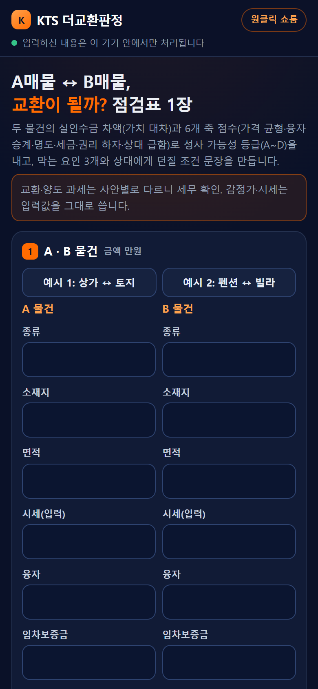
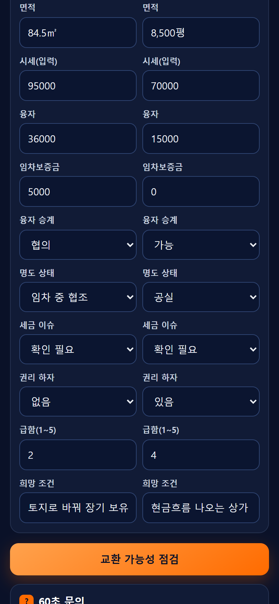
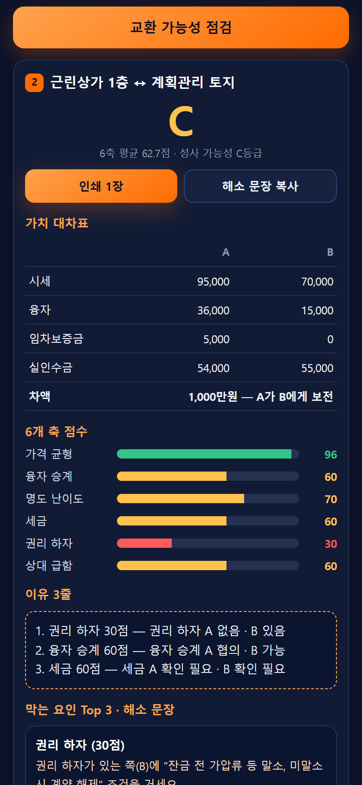

# KTS 더교환판정 — A매물 ↔ B매물 교환 성사 가능성 점검표 사용설명서

- 앱: `oneclick/swapcheck.html` (단일 HTML · 설치 없음 · 서버 0)
- A·B 물건(시세·융자·보증금·융자 승계·명도·세금·권리 하자·급함)을 넣으면 실인수금 차액과 6개 축 점수로 A~D 등급과 이유 3줄, 막는 요인 Top 3와 해소 문장을 만듭니다. 점수 규칙은 화면에 공개합니다.
- 입력하신 내용은 이 기기 안에서만 처리됩니다.

## ① 누르는 곳

[예시 1: 상가 ↔ 토지] 또는 [예시 2: 펜션 ↔ 빌라]를 누르세요.

## ② 입력

A·B 칸을 확인하고 [교환 가능성 점검]을 누릅니다.

## ③ 결과

등급·가치 대차표·6축 막대·해소 문장이 나옵니다. [해소 문장 복사] · [인쇄 1장].

## 60초 문의
화면 맨 아래 **[60초 문의 폼 열기]** 를 누르면 KTS 60초 접수 폼(`misa-1116/form.html`)이 열립니다. 이름·연락처·문의만 남기면 됩니다.

> 390px 실물 캡처: `390_swapcheck.png` · 실제로 누른 자리 기록: `shots/swapcheck/marks.json` · 검증 로그: `shots/swapcheck/run_log.txt`