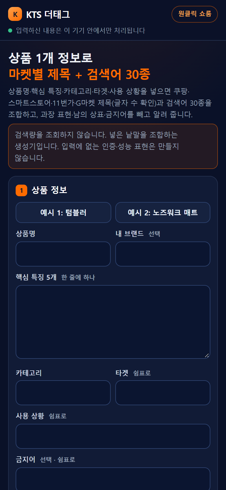
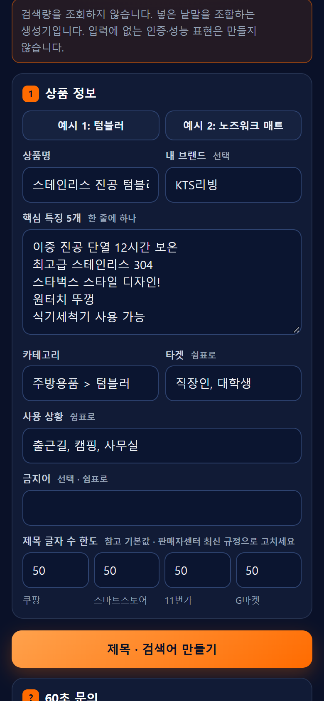
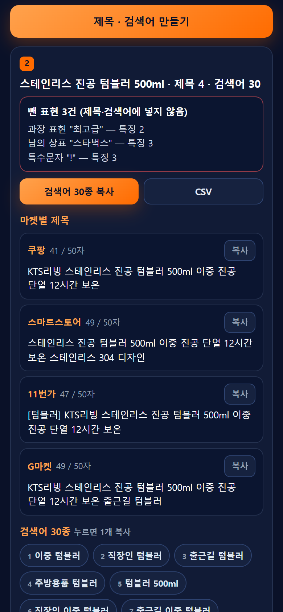

# KTS 더태그 — 상품 1개 → 마켓 등록용 제목·태그·검색어 30종 사용설명서

- 앱: `oneclick/tagmaker.html` (단일 HTML · 설치 없음 · 서버 0)
- 상품명·핵심 특징·카테고리·타겟·사용 상황을 넣으면 쿠팡·스마트스토어·11번가·G마켓 제목(글자 수 한도 수정 가능)과 넣은 낱말만 조합한 검색어 30종을 만들고, 과장 표현·남의 상표·특수문자·금지어를 빼고 알려 줍니다. 검색량은 조회하지 않습니다.
- 입력하신 내용은 이 기기 안에서만 처리됩니다.

## ① 누르는 곳

[예시 1: 텀블러] 또는 [예시 2: 노즈워크 매트]를 누르세요.

## ② 입력

제목 글자 수 한도를 확인하고 [제목 · 검색어 만들기]를 누릅니다.

## ③ 결과

뺀 표현 경고·마켓별 제목·검색어 30종이 나옵니다. 제목은 [복사], 검색어는 눌러서 1개씩 복사, [검색어 30종 복사] · [CSV].

## 60초 문의
화면 맨 아래 **[60초 문의 폼 열기]** 를 누르면 KTS 60초 접수 폼(`misa-1116/form.html`)이 열립니다. 이름·연락처·문의만 남기면 됩니다.

> 390px 실물 캡처: `390_tagmaker.png` · 실제로 누른 자리 기록: `shots/tagmaker/marks.json` · 검증 로그: `shots/tagmaker/run_log.txt`