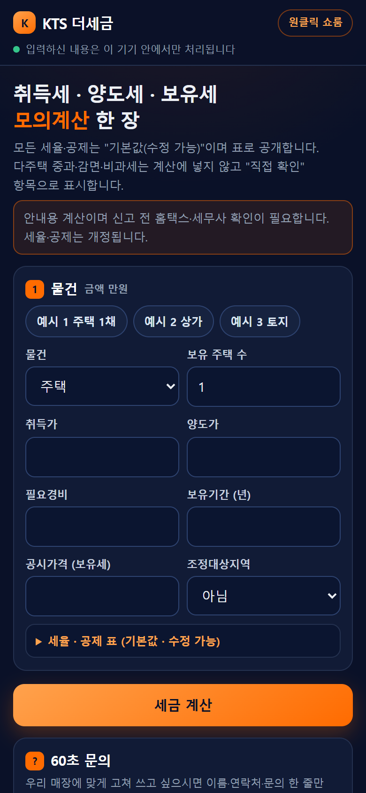
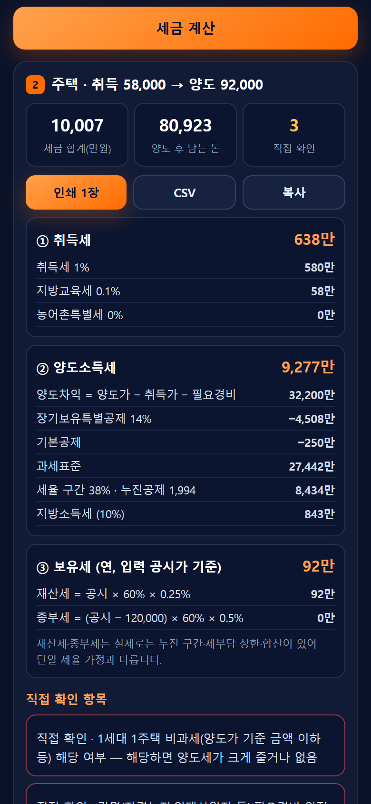

# KTS 더세금 — 취득·양도·보유세 모의계산 사용설명서

- 앱: `oneclick/taxsim.html` (단일 HTML · 설치 없음 · 서버 0)
- 물건 종류·취득가·양도가·보유기간·보유 주택 수·필요경비·공시가를 넣으면 취득세, 양도소득세(누진 구간 표 공개), 보유세를 계산합니다. 모든 세율·공제는 기본값이며 화면에서 고칠 수 있습니다. 중과·감면은 "직접 확인" 목록으로 보여 줍니다.
- 입력하신 내용은 이 기기 안에서만 처리됩니다.

## ① 누르는 곳

[예시 1: 주택 1채](또는 상가·토지 예시)를 누르세요.

## ② 입력

세율 표를 확인(필요하면 수정)하고 [세금 모의계산]을 누릅니다.

## ③ 결과

세금 3종·합계·양도 후 남는 돈과 직접 확인 목록이 나옵니다. [인쇄] · [CSV] · [복사]. 신고 전 세무 확인이 필요합니다.

## 60초 문의
화면 맨 아래 **[60초 문의 폼 열기]** 를 누르면 KTS 60초 접수 폼(`misa-1116/form.html`)이 열립니다. 이름·연락처·문의만 남기면 됩니다.

> 390px 실물 캡처: `390_taxsim.png` · 실제로 누른 자리 기록: `shots/taxsim/marks.json` · 검증 로그: `shots/taxsim/run_log.txt`