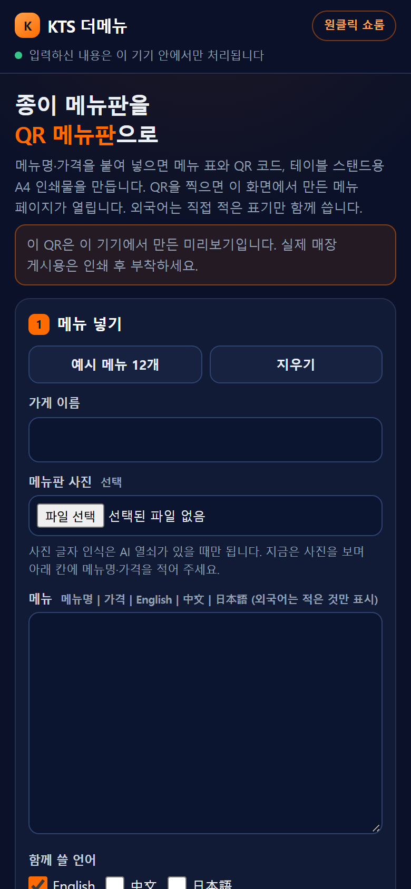
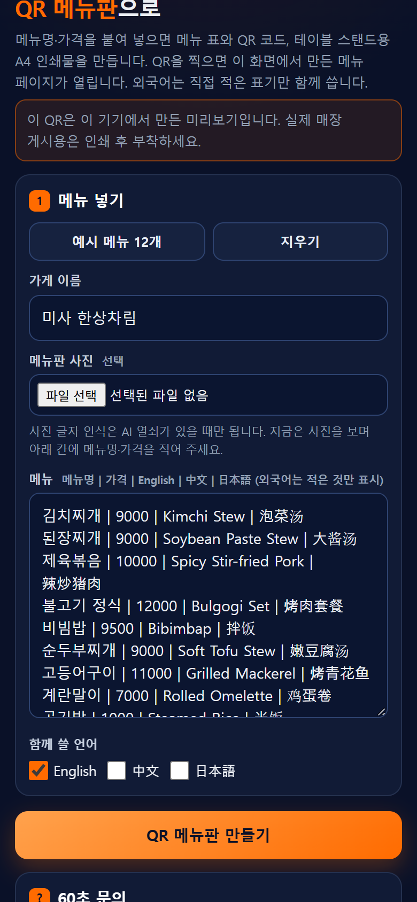
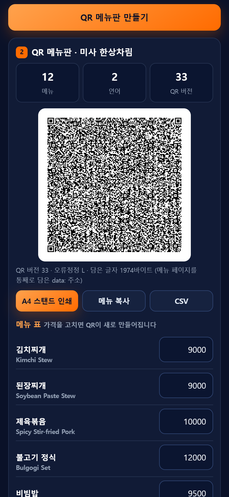

# KTS 더메뉴 — 종이 메뉴판 → QR 메뉴판 사용설명서

- 앱: `oneclick/themenu.html` (단일 HTML · 설치 없음 · 서버 0)
- 메뉴명·가격(외국어는 직접 적은 표기)을 넣으면 메뉴 표, QR 코드, QR로 열리는 메뉴 페이지, 테이블 스탠드용 A4 인쇄물을 만듭니다. QR은 이 화면 안에서 만들며(외부 라이브러리 0) 이 기기에서 만든 미리보기입니다.
- 입력하신 내용은 이 기기 안에서만 처리됩니다.

## ① 누르는 곳

[예시 메뉴 12개]를 누르거나, 메뉴를 "메뉴명 | 가격 | English" 형식으로 한 줄에 하나씩 적으세요.

## ② 입력

가게 이름과 함께 쓸 언어를 고르고 [QR 메뉴판 만들기]를 누릅니다.

## ③ 결과

QR과 메뉴 표가 나옵니다. 가격 칸을 고치면 QR이 새로 만들어집니다. [A4 스탠드 인쇄]로 뽑아 부착하세요.

## 60초 문의
화면 맨 아래 **[60초 문의 폼 열기]** 를 누르면 KTS 60초 접수 폼(`misa-1116/form.html`)이 열립니다. 이름·연락처·문의만 남기면 됩니다.

> 390px 실물 캡처: `390_themenu.png` · 실제로 누른 자리 기록: `shots/themenu/marks.json` · 검증 로그: `shots/themenu/run_log.txt`