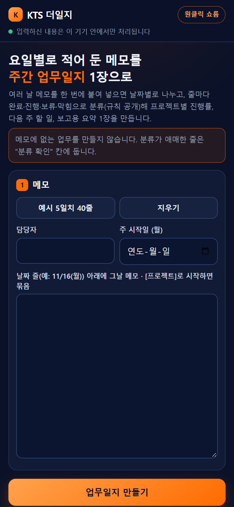
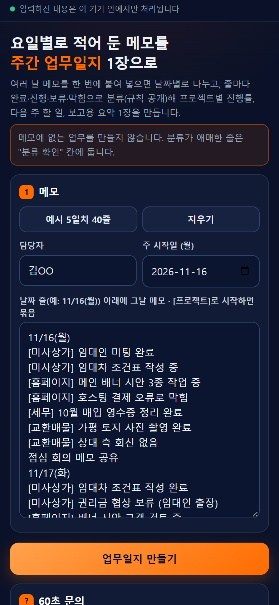
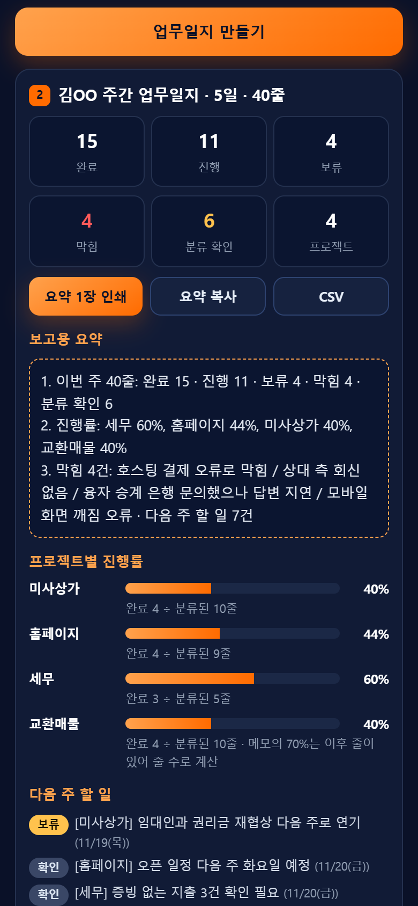

# KTS 더일지 — 흩어진 업무 메모 → 주간 업무일지·진행률 사용설명서

- 앱: `oneclick/weeklog.html` (단일 HTML · 설치 없음 · 서버 0)
- 날짜 줄(예: 11/16(월)) 아래에 적은 메모를 한 번에 붙여 넣으면 날짜별로 나누고 줄마다 완료·진행·보류·막힘으로 분류해 프로젝트별 진행률, 다음 주 할 일, 보고용 요약 1장을 만듭니다. 메모에 없는 업무는 만들지 않습니다.
- 입력하신 내용은 이 기기 안에서만 처리됩니다.

## ① 누르는 곳

[예시 5일치 40줄]을 누르거나 메모를 붙여 넣으세요. [프로젝트]로 시작하면 묶입니다.

## ② 입력

담당자·주 시작일을 확인하고 [업무일지 만들기]를 누릅니다.

## ③ 결과

요약 3줄·진행률 막대·다음 주 할 일·분류 확인이 나옵니다. [요약 1장 인쇄] · [요약 복사] · [CSV].

## 60초 문의
화면 맨 아래 **[60초 문의 폼 열기]** 를 누르면 KTS 60초 접수 폼(`misa-1116/form.html`)이 열립니다. 이름·연락처·문의만 남기면 됩니다.

> 390px 실물 캡처: `390_weeklog.png` · 실제로 누른 자리 기록: `shots/weeklog/marks.json` · 검증 로그: `shots/weeklog/run_log.txt`