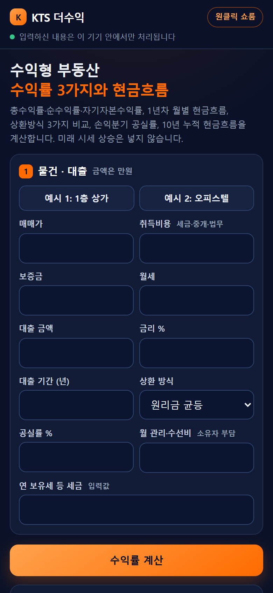
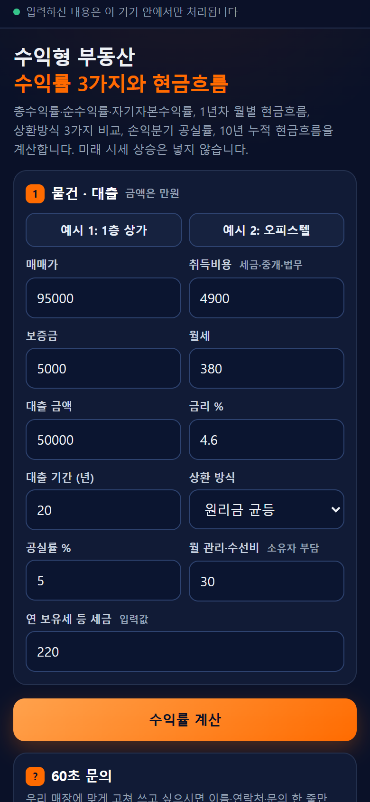
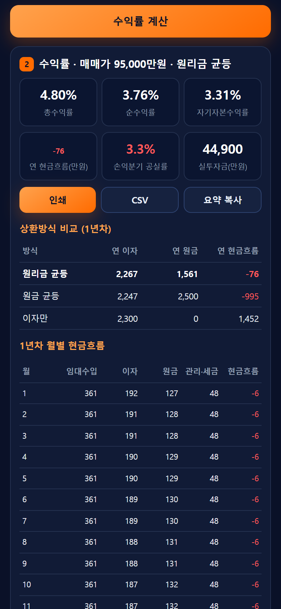

# KTS 더수익 — 수익형 부동산 수익률·현금흐름 계산기 사용설명서

- 앱: `oneclick/yieldcalc.html` (단일 HTML · 설치 없음 · 서버 0)
- 매매가·보증금·월세·대출(금액·금리·기간·상환방식)·공실률·관리비·세금(입력)을 넣으면 총·순·자기자본 수익률, 1년차 월별 현금흐름, 상환방식 비교, 손익분기 공실률, 10년 누적 현금흐름을 계산합니다. 시세 상승은 넣지 않습니다.
- 입력하신 내용은 이 기기 안에서만 처리됩니다.

## ① 누르는 곳

[예시 1: 1층 상가] 또는 [예시 2: 오피스텔]을 누르세요.

## ② 입력

금액(만원)·금리·상환방식을 확인하고 [수익률 계산]을 누릅니다.

## ③ 결과

수익률 3가지·손익분기 공실률·표가 나옵니다. 적자 현금흐름은 빨간색. [인쇄] · [CSV] · [요약 복사].

## 60초 문의
화면 맨 아래 **[60초 문의 폼 열기]** 를 누르면 KTS 60초 접수 폼(`misa-1116/form.html`)이 열립니다. 이름·연락처·문의만 남기면 됩니다.

> 390px 실물 캡처: `390_yieldcalc.png` · 실제로 누른 자리 기록: `shots/yieldcalc/marks.json` · 검증 로그: `shots/yieldcalc/run_log.txt`