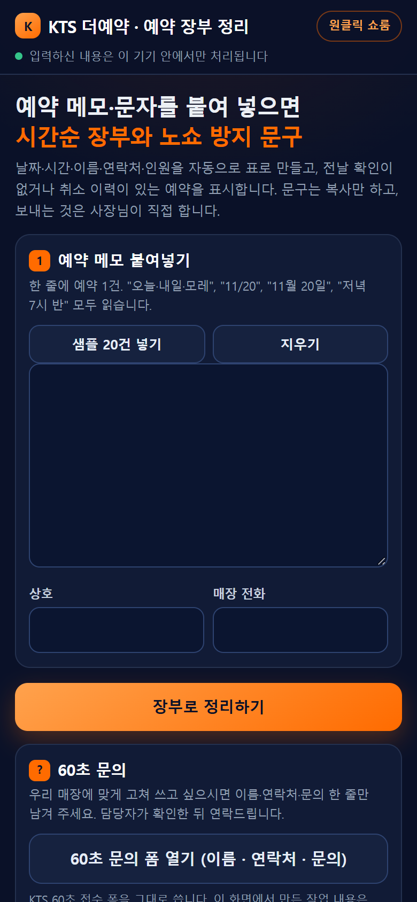
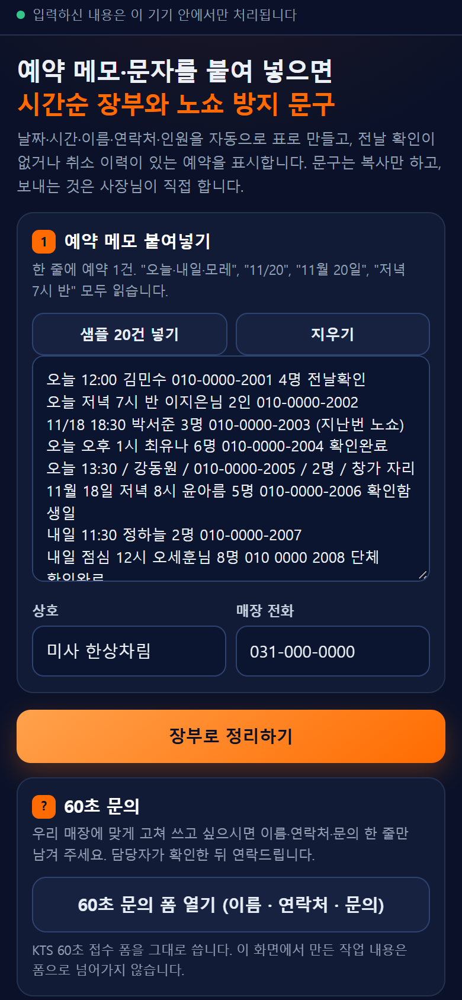
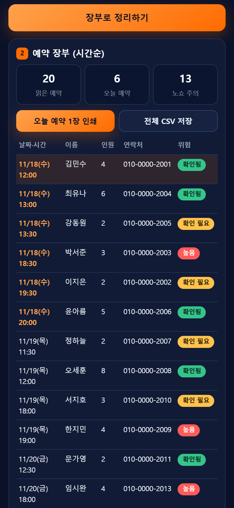

# KTS 더예약 — 예약 장부 + 노쇼 방지 문구 사용설명서

- 앱: `oneclick/booking.html` (단일 HTML · 설치 없음 · 서버 0)
- 예약 메모·문자를 붙여 넣으면 날짜·시간·이름·연락처·인원을 시간순 표로 만들고, 전날 확인이 없거나 노쇼·취소 이력이 있는 예약을 표시합니다. 예약 확인·전날 리마인드·노쇼 안내 문구 3종을 만들고, 오늘 예약만 한 장으로 인쇄합니다.
- 입력하신 내용은 이 기기 안에서만 처리됩니다.

## ① 누르는 곳

[샘플 20건 넣기]를 누르거나 예약 메모를 한 줄에 1건씩 붙여 넣으세요("오늘 저녁 7시 반 홍길동 2명 010-…").

## ② 입력

상호·매장 전화를 확인하고 [장부로 정리하기]를 누릅니다.

## ③ 결과

시간순 장부와 위험 표시가 나옵니다. [오늘 예약 1장 인쇄], 줄을 눌러 고른 예약의 문구 3종을 [복사]하세요. 문자는 사장님이 직접 보냅니다.

## 60초 문의
화면 맨 아래 **[60초 문의 폼 열기]** 를 누르면 KTS 60초 접수 폼(`misa-1116/form.html`)이 열립니다. 이름·연락처·문의만 남기면 됩니다.

> 390px 실물 캡처: `390_booking.png` · 실제로 누른 자리 기록: `shots/booking/marks.json` · 검증 로그: `shots/booking/run_log.txt`