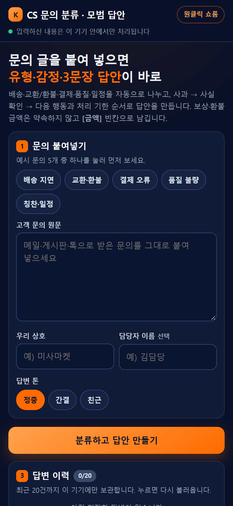
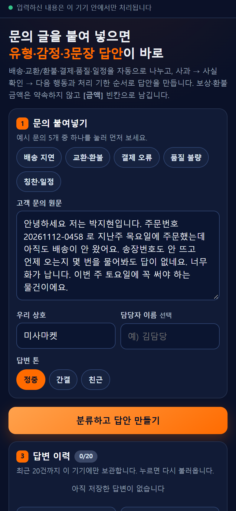
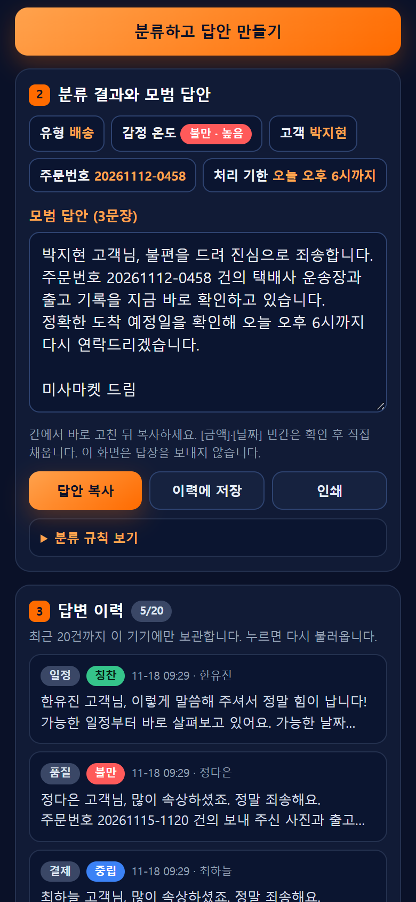

# CS 문의 분류 · 모범 답안 사용설명서

- 앱: `oneclick/csreply.html` (단일 HTML · 설치 없음 · 서버 0)
- 고객 문의 글을 붙여 넣으면 유형(배송·교환/환불·결제·품질·일정)과 감정 온도를 읽고, 사과 → 사실 확인 → 다음 행동과 처리 기한 순서의 3문장 답안을 만듭니다. 보상·환불 금액은 [금액] 빈칸으로 남깁니다.
- 입력하신 내용은 이 기기 안에서만 처리됩니다.

## ① 누르는 곳

예시 문의 단추(배송 지연 등)를 누르거나 받은 문의를 그대로 붙여 넣으세요.

## ② 입력

상호·담당자와 답변 톤(정중·간결·친근)을 고르고 [분류하고 답안 만들기]를 누릅니다.

## ③ 결과

유형·감정·고객 이름·주문번호·처리 기한이 표시되고 답안이 나옵니다. 칸에서 고친 뒤 [답안 복사], [이력에 저장](최근 20건)을 누르세요.

## 60초 문의
화면 맨 아래 **[60초 문의 폼 열기]** 를 누르면 KTS 60초 접수 폼(`misa-1116/form.html`)이 열립니다. 이름·연락처·문의만 남기면 됩니다.

> 390px 실물 캡처: `390_csreply.png` · 실제로 누른 자리 기록: `shots/csreply/marks.json` · 검증 로그: `shots/csreply/run_log.txt`