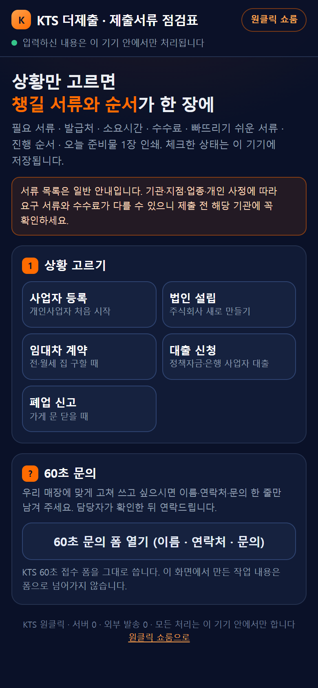
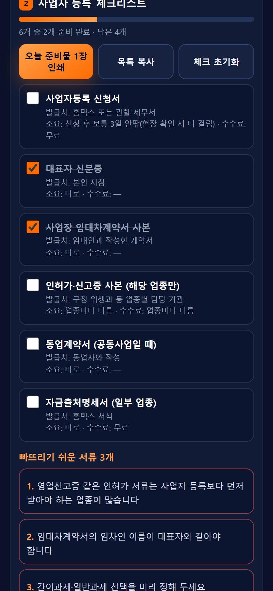
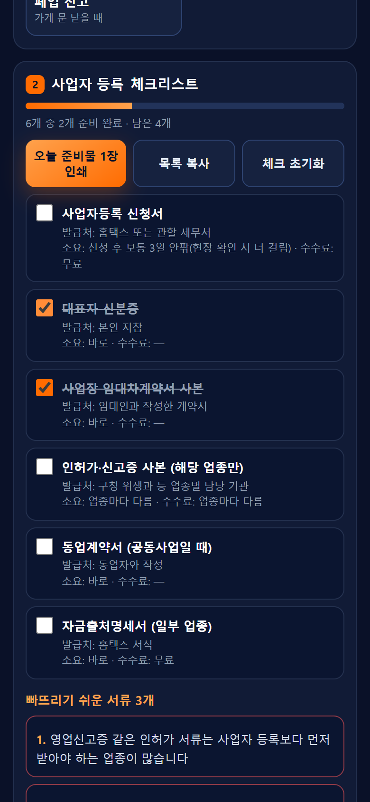

# KTS 더제출 — 제출서류 세트 점검표 사용설명서

- 앱: `oneclick/docs.html` (단일 HTML · 설치 없음 · 서버 0)
- 상황(사업자 등록·법인 설립·임대차·대출·폐업)을 고르면 필요한 서류, 발급처·소요시간·수수료, 빠뜨리기 쉬운 서류 3개, 진행 순서, 공식 사이트가 나옵니다. 서류 목록은 일반 안내이며 기관별로 다를 수 있습니다.
- 입력하신 내용은 이 기기 안에서만 처리됩니다.

## ① 누르는 곳

내 상황 단추(사업자 등록 등)를 누르세요.

## ② 입력

준비한 서류를 체크합니다. 체크 상태는 이 기기에 저장되어 다음에 열어도 그대로입니다.

## ③ 결과

남은 서류 개수가 보입니다. [오늘 준비물 1장 인쇄]로 들고 가고, [목록 복사]로 메모에 붙이세요.

## 60초 문의
화면 맨 아래 **[60초 문의 폼 열기]** 를 누르면 KTS 60초 접수 폼(`misa-1116/form.html`)이 열립니다. 이름·연락처·문의만 남기면 됩니다.

> 390px 실물 캡처: `390_docs.png` · 실제로 누른 자리 기록: `shots/docs/marks.json` · 검증 로그: `shots/docs/run_log.txt`