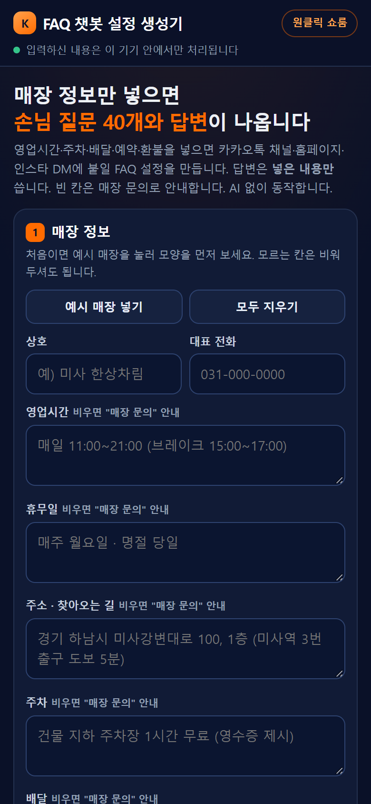
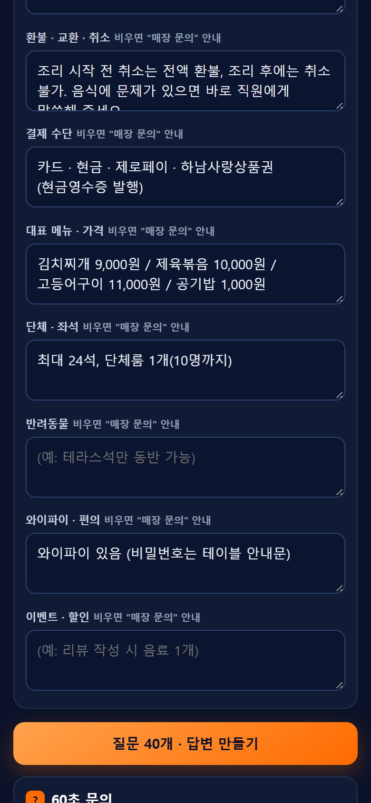
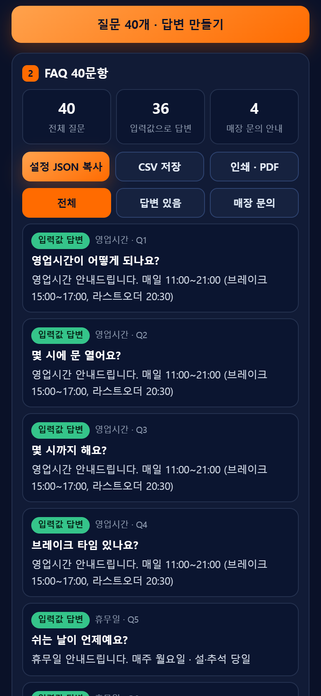

# FAQ 챗봇 설정 생성기 사용설명서

- 앱: `oneclick/faqbot.html` (단일 HTML · 설치 없음 · 서버 0)
- 매장 정보를 넣으면 손님이 물을 질문 40개와 답변, 카톡 채널·홈페이지·DM에 붙일 설정 JSON이 나옵니다. 답변은 넣은 내용만 쓰고, 빈 칸은 "매장으로 문의" 안내로 고정됩니다.
- 입력하신 내용은 이 기기 안에서만 처리됩니다.

## ① 누르는 곳

[예시 매장 넣기]를 누르세요. 내 매장이면 상호·전화와 영업시간·주차·배달·예약·환불 칸을 적습니다(모르는 칸은 비워 둡니다).

## ② 입력

채운 내용을 확인하고 [질문 40개 · 답변 만들기]를 누릅니다.

## ③ 결과

질문 40개와 답변이 나옵니다. [설정 JSON 복사] · [CSV 저장] · [인쇄 · PDF] 중 하나로 가져가세요. 아래 "손님처럼 물어보기"로 답이 맞는지 시험할 수 있습니다.

## 60초 문의
화면 맨 아래 **[60초 문의 폼 열기]** 를 누르면 KTS 60초 접수 폼(`misa-1116/form.html`)이 열립니다. 이름·연락처·문의만 남기면 됩니다.

> 390px 실물 캡처: `390_faqbot.png` · 실제로 누른 자리 기록: `shots/faqbot/marks.json` · 검증 로그: `shots/faqbot/run_log.txt`