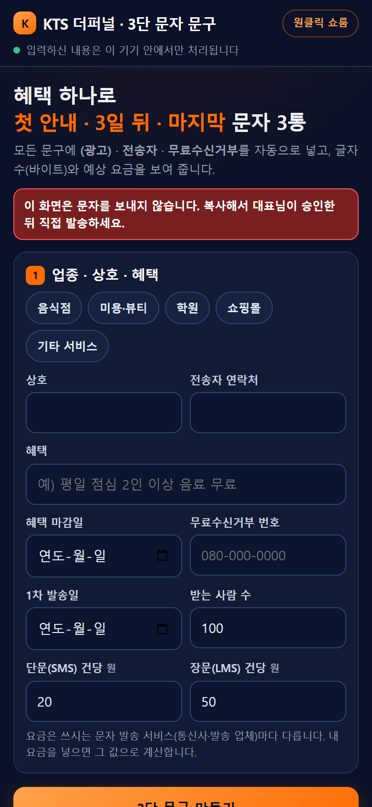
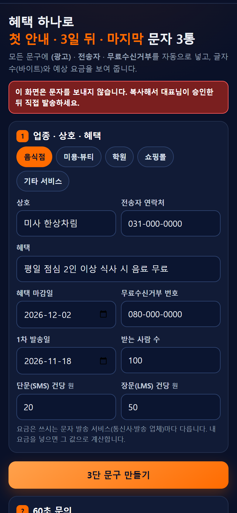
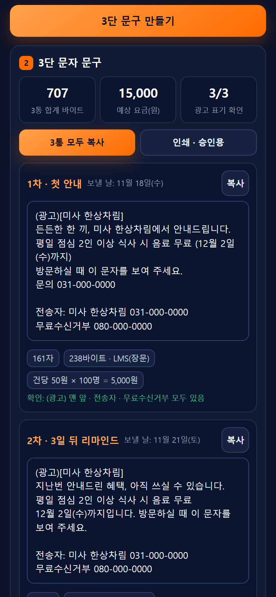

# KTS 더퍼널 — 3단 문자 퍼널 문구 사용설명서

- 앱: `oneclick/funnel3.html` (단일 HTML · 설치 없음 · 서버 0)
- 업종·상호·혜택·연락처를 넣으면 1차(첫 안내)·2차(3일 뒤)·3차(마지막) 문구를 만들고, 모든 문구에 (광고)·전송자·무료수신거부를 자동으로 넣습니다. 글자 수(바이트)·SMS/LMS·예상 요금을 보여 줍니다. 이 화면은 문자를 보내지 않습니다.
- 입력하신 내용은 이 기기 안에서만 처리됩니다.

## ① 누르는 곳

업종 단추(음식점 등)를 누르세요. 상호·연락처·혜택·마감일이 채워집니다.

## ② 입력

혜택·수신거부 번호·받는 사람 수·건당 요금을 확인하고 [3단 문구 만들기]를 누릅니다.

## ③ 결과

문구 3통과 바이트·요금, 광고 표기 확인이 나옵니다. [3통 모두 복사] 또는 [인쇄 · 승인용]으로 대표님 승인을 받은 뒤 직접 발송하세요.

## 60초 문의
화면 맨 아래 **[60초 문의 폼 열기]** 를 누르면 KTS 60초 접수 폼(`misa-1116/form.html`)이 열립니다. 이름·연락처·문의만 남기면 됩니다.

> 390px 실물 캡처: `390_funnel3.png` · 실제로 누른 자리 기록: `shots/funnel3/marks.json` · 검증 로그: `shots/funnel3/run_log.txt`