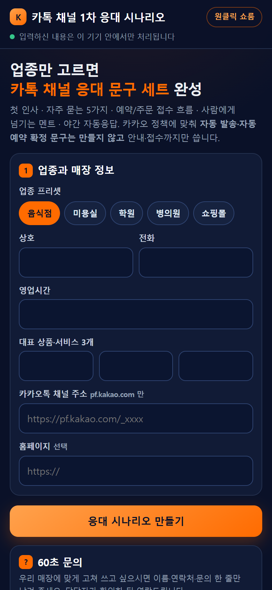
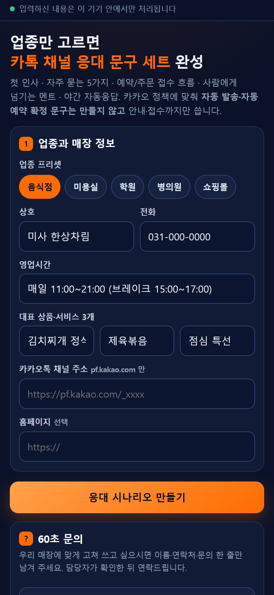
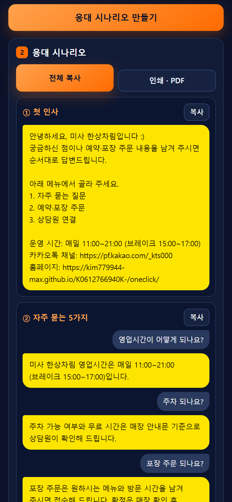

# 카카오톡 채널 1차 응대 시나리오 사용설명서

- 앱: `oneclick/kakaotalk.html` (단일 HTML · 설치 없음 · 서버 0)
- 업종만 고르면 첫 인사, 자주 묻는 5가지, 예약·주문 접수 흐름, 상담원 인계 멘트, 야간 자동응답 문구가 나옵니다. 자동 발송·자동 예약 확정 문구는 만들지 않습니다(안내·접수까지만).
- 입력하신 내용은 이 기기 안에서만 처리됩니다.

## ① 누르는 곳

업종 프리셋(음식점·미용실·학원·병의원·쇼핑몰) 중 하나를 누르세요. 상호·전화·영업시간·대표 상품 3개가 채워집니다.

## ② 입력

내 매장에 맞게 고치고, 카카오톡 채널 주소(pf.kakao.com)·홈페이지를 넣은 뒤 [응대 시나리오 만들기]를 누릅니다.

## ③ 결과

단계별 말풍선 문구가 나옵니다. 칸마다 [복사], 전체는 [전체 복사], 문서로는 [인쇄 · PDF]. 채널 관리자센터 자동응답에 붙여 넣으세요.

## 60초 문의
화면 맨 아래 **[60초 문의 폼 열기]** 를 누르면 KTS 60초 접수 폼(`misa-1116/form.html`)이 열립니다. 이름·연락처·문의만 남기면 됩니다.

> 390px 실물 캡처: `390_kakaotalk.png` · 실제로 누른 자리 기록: `shots/kakaotalk/marks.json` · 검증 로그: `shots/kakaotalk/run_log.txt`