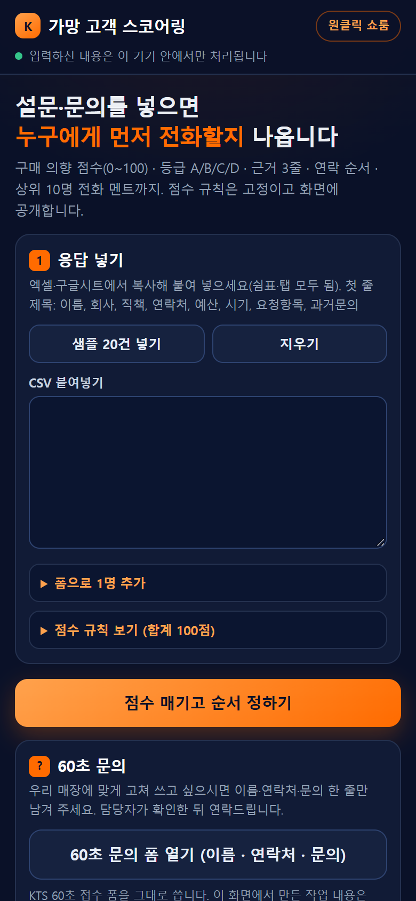
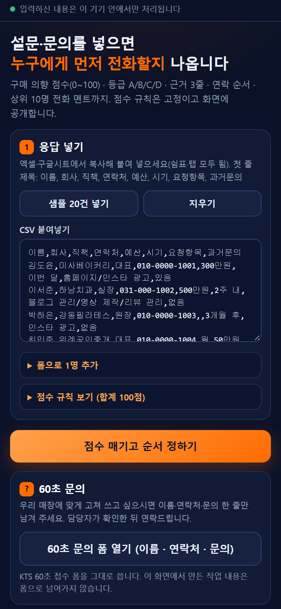
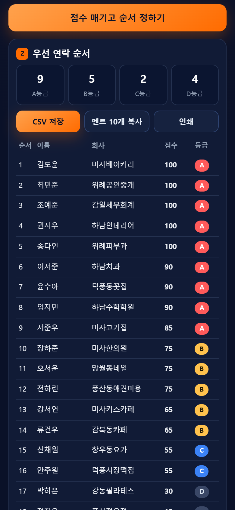

# 가망 고객 스코어링 사용설명서

- 앱: `oneclick/leadscore.html` (단일 HTML · 설치 없음 · 서버 0)
- 설문·문의 응답을 넣으면 구매 의향 점수(0~100), 등급 A/B/C/D, 근거 3줄, 우선 연락 순서, 상위 10명 전화 멘트가 나옵니다. 점수 규칙(예산 25 · 시기 20 · 담당/대표 15 · 연락처 15 · 요청 2개+ 15 · 과거 문의 10)은 화면에 공개됩니다.
- 입력하신 내용은 이 기기 안에서만 처리됩니다.

## ① 누르는 곳

[샘플 20건 넣기]를 누르거나 엑셀·구글시트에서 복사한 응답을 붙여 넣으세요. 한 명씩은 [폼으로 1명 추가]로 넣습니다.

## ② 입력

붙여 넣은 표를 확인하고 [점수 매기고 순서 정하기]를 누릅니다.

## ③ 결과

등급별 인원과 연락 순서표가 나옵니다. [CSV 저장]으로 받고, [멘트 10개 복사]로 전화할 때 쓰세요. 아래로 내리면 고객별 근거 3줄이 있습니다.

## 60초 문의
화면 맨 아래 **[60초 문의 폼 열기]** 를 누르면 KTS 60초 접수 폼(`misa-1116/form.html`)이 열립니다. 이름·연락처·문의만 남기면 됩니다.

> 390px 실물 캡처: `390_leadscore.png` · 실제로 누른 자리 기록: `shots/leadscore/marks.json` · 검증 로그: `shots/leadscore/run_log.txt`