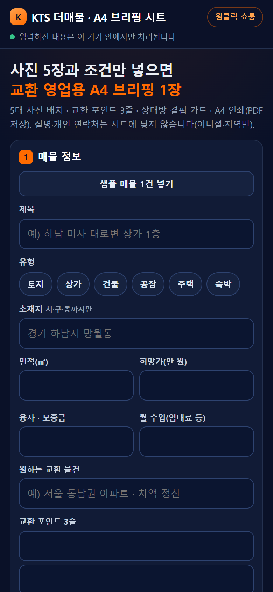
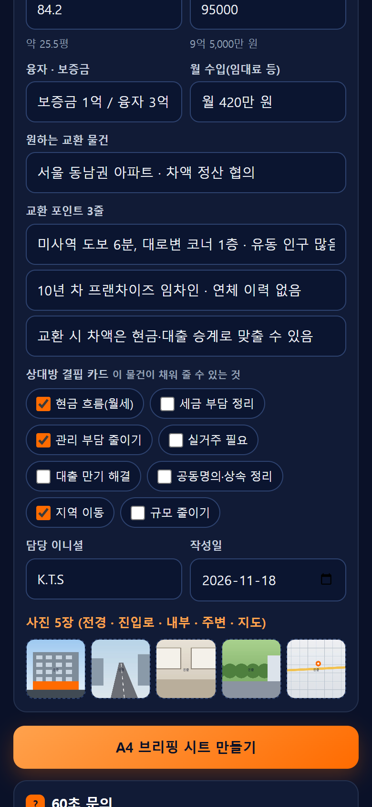
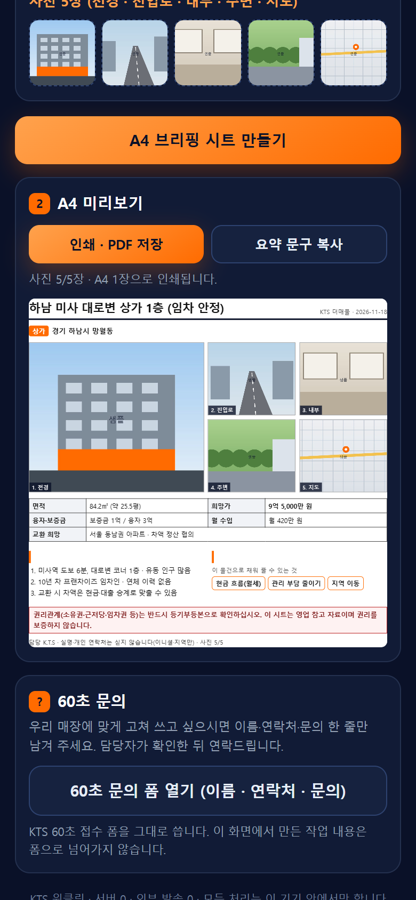

# KTS 더매물 — 매물 A4 브리핑 시트 사용설명서

- 앱: `oneclick/listing.html` (단일 HTML · 설치 없음 · 서버 0)
- 매물 정보(소재지·면적·가격·교환 조건)와 사진 5장을 넣으면 5대 사진 배치, 교환 포인트 3줄, 상대방 결핍 카드가 들어간 A4 한 장이 나옵니다. 실명·개인 연락처는 시트에 넣지 않고(이니셜·지역만), "권리관계는 등기부등본 확인" 문구가 고정됩니다.
- 입력하신 내용은 이 기기 안에서만 처리됩니다.

## ① 누르는 곳

[샘플 매물 1건 넣기]를 누르거나 제목·유형·소재지(동까지)·면적·희망가를 적으세요.

## ② 입력

교환 포인트 3줄, 상대방 결핍 카드, 사진 5칸(전경·진입로·내부·주변·지도)을 채우고 [A4 브리핑 시트 만들기]를 누릅니다.

## ③ 결과

A4 미리보기가 나옵니다. [인쇄 · PDF 저장]으로 한 장을 뽑고, [요약 문구 복사]로 메신저에 붙이세요.

## 60초 문의
화면 맨 아래 **[60초 문의 폼 열기]** 를 누르면 KTS 60초 접수 폼(`misa-1116/form.html`)이 열립니다. 이름·연락처·문의만 남기면 됩니다.

> 390px 실물 캡처: `390_listing.png` · 실제로 누른 자리 기록: `shots/listing/marks.json` · 검증 로그: `shots/listing/run_log.txt`