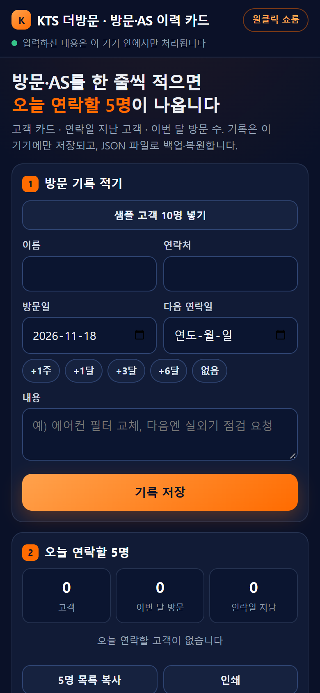
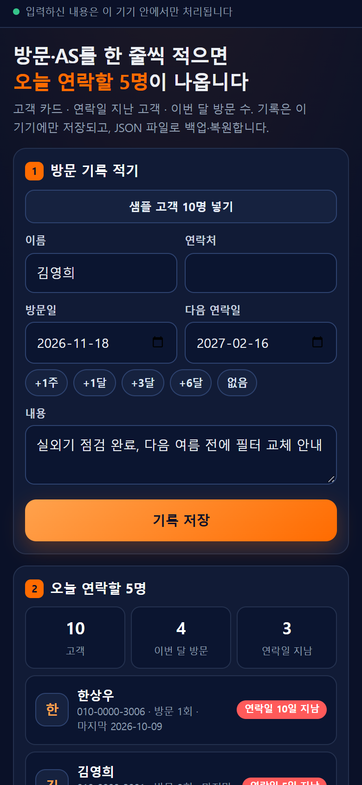
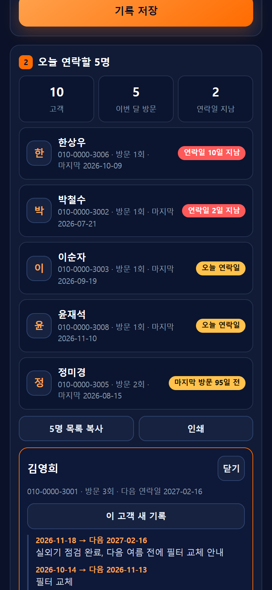

# KTS 더방문 — 고객 방문·AS 이력 카드 사용설명서

- 앱: `oneclick/visitlog.html` (단일 HTML · 설치 없음 · 서버 0)
- 고객별 방문·AS 기록(이름·연락처·방문일·내용·다음 연락일)을 적으면 고객 카드, 연락일이 지난 고객, 이번 달 방문 수, 오늘 연락할 5명을 보여 줍니다. 기록은 이 기기에만 저장되고 JSON 파일로 백업·복원합니다.
- 입력하신 내용은 이 기기 안에서만 처리됩니다.

## ① 누르는 곳

처음이면 [샘플 고객 10명 넣기]를 누르세요.

## ② 입력

이름·내용을 적고 다음 연락일은 [+1주]·[+3달] 같은 단추로 고른 뒤 [기록 저장]을 누릅니다(같은 이름이면 연락처는 자동으로 채움).

## ③ 결과

오늘 연락할 5명과 고객 카드가 나옵니다. [5명 목록 복사]·[인쇄]로 쓰고, 아래 [JSON 내보내기]로 꼭 백업하세요.

## 60초 문의
화면 맨 아래 **[60초 문의 폼 열기]** 를 누르면 KTS 60초 접수 폼(`misa-1116/form.html`)이 열립니다. 이름·연락처·문의만 남기면 됩니다.

> 390px 실물 캡처: `390_visitlog.png` · 실제로 누른 자리 기록: `shots/visitlog/marks.json` · 검증 로그: `shots/visitlog/run_log.txt`