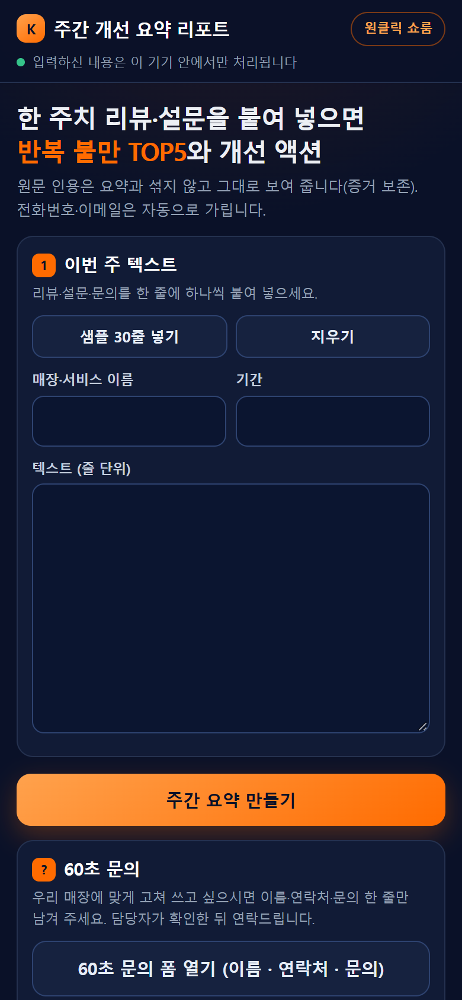
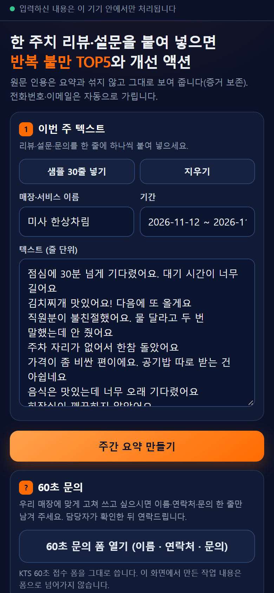
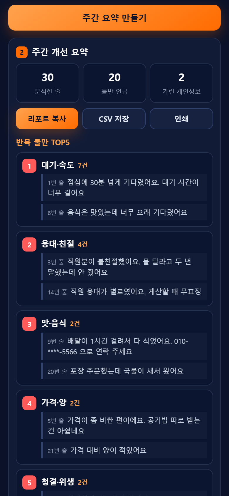

# 주간 개선 요약 리포트 사용설명서

- 앱: `oneclick/weeksummary.html` (단일 HTML · 설치 없음 · 서버 0)
- 한 주치 리뷰·설문·문의 텍스트를 줄 단위로 붙여 넣으면 반복 불만 TOP5(건수·원문 인용), 좋은 점 TOP3, 이번 주 개선 액션 3개, 다음 주 확인 지표를 만듭니다. 원문 인용은 그대로 두고, 전화·이메일만 자동으로 가립니다.
- 입력하신 내용은 이 기기 안에서만 처리됩니다.

## ① 누르는 곳

[샘플 30줄 넣기]를 누르거나 리뷰·설문을 한 줄에 하나씩 붙여 넣으세요.

## ② 입력

매장 이름·기간을 확인하고 [주간 요약 만들기]를 누릅니다.

## ③ 결과

불만 TOP5와 원문 인용이 나옵니다. 액션마다 담당·기한을 적고 [리포트 복사] · [CSV 저장] · [인쇄]로 가져가세요.

## 60초 문의
화면 맨 아래 **[60초 문의 폼 열기]** 를 누르면 KTS 60초 접수 폼(`misa-1116/form.html`)이 열립니다. 이름·연락처·문의만 남기면 됩니다.

> 390px 실물 캡처: `390_weeksummary.png` · 실제로 누른 자리 기록: `shots/weeksummary/marks.json` · 검증 로그: `shots/weeksummary/run_log.txt`